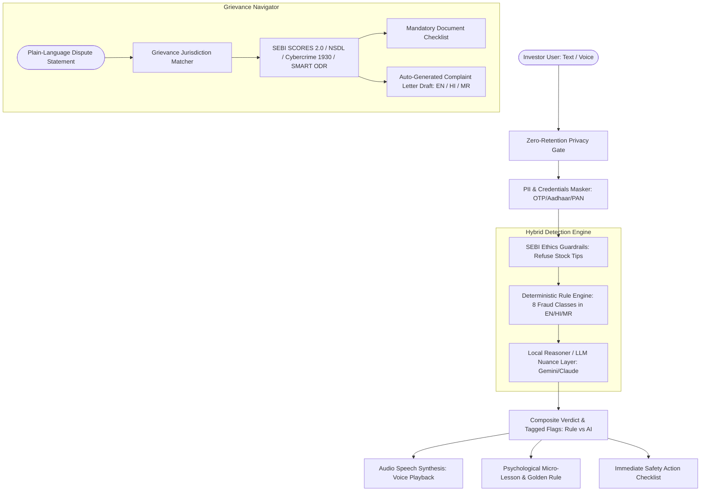

# 🛡️ Nivesh Suraksha (निवेश सुरक्षा)
### Multilingual Investor Scam Checker & Grievance Guide
**Built for the SANGYAN Hackathon • Organized by IIT BHU with SEBI & NSDL**

---

## 📌 Problem & Motivation
First-time retail investors across Tier-2 and Tier-3 India are targeted on WhatsApp, Telegram, and social media with fraudulent "100% guaranteed returns", fake SEBI certificates, and operator pump-and-dump tips. When victimized, retail investors face confusing regulatory channels and miss the critical **Golden Hour (2–4 hours)** required to freeze stolen funds.

**Nivesh Suraksha** empowers investors to **Detect** scams in real time, **Understand** the psychological traps being deployed, and **Act** by generating ready-to-copy legal complaints addressed to official authorities.

---

## 🏛️ Architecture Overview



---

## ✨ Core Features

1. **Multilingual Scam Checker:**
   - Analyzes suspicious messages in **English**, **Hindi (हिन्दी)**, and **Marathi (मराठी)**.
   - **Voice Input:** Speak suspicious tips directly using the browser's Web Speech API.
   - **Hybrid Attribution:** Clearly demarcates flags detected via `[Rule Engine]` vs `[AI Nuance Analysis]`.
   - **Verdicts:** *"Likely scam"*, *"Suspicious"*, *"No clear red flags found"*, and an explicit *"I'm not sure"* state.
   - **Audio Playback:** Text-to-speech audio pronunciation of verdicts for low-literacy and elderly investors.

2. **Psychological Micro-Lessons:**
   - Teaches investors *why* they were vulnerable (e.g. *The Certainty Illusion*, *Fabricated Urgency*, *The Social Proof Trap*).
   - Equips users with a memorable golden rule: *"In finance, if the return is guaranteed, the fraud is guaranteed."*

3. **SEBI Advisor Legitimacy Guide:**
   - Explains official registration prefixes: `INA` (Investment Advisers) and `INH` (Research Analysts).
   - Details 4 common impersonation tricks (fake certificates, personal UPI payment requests, 50-50 profit splits).
   - Provides direct, unadulterated links out to SEBI's official recognized intermediaries database (`sebi.gov.in`).

4. **Plain-Language Grievance Navigator:**
   - Translates casual problem statements into official jurisdictions: **Broker Grievance**, **Depository (NSDL/CDSL)**, **SEBI SCORES 2.0**, **SMART ODR**, or **National Cybercrime Reporting Portal (1930 / cybercrime.gov.in)**.
   - Generates an interactive document checklist with checkable items.
   - Automatically writes a **ready-to-copy formal complaint letter** in English, Hindi, or Marathi with 1-click clipboard copying.

5. **Accessibility for Elderly & Rural Users:**
   - Dedicated **High-Contrast Mode** for vision impairment.
   - **Dynamic Font Scaling (Aa+ / Aa-)** for increased legibility.
   - Large, thumb-friendly tap targets and mobile-first design.

---

## 🔒 Hard Guardrails & Privacy-by-Design

- **Zero Data Retention:** No databases, no user profiling, no message logging. All requests are processed strictly in-memory.
- **Automatic PII & Credential Masking:** Live client-side and server-side detection for Aadhaar (12 digits), PAN, phone numbers, OTPs, UPI PINs, and bank accounts.
- **Strict SEBI Advisory Compliance:** Hard regulatory filters immediately reject any queries requesting stock tips, buy/sell targets, or market predictions, redirecting users to verified SEBI RIAs.
- **Zero Commercial Bias:** No broker promotions, no affiliate links, no monetization.

---

## 📂 Project Structure

```
nivesh-suraksha/
├── client/                               # Frontend (React 18 + Vite + Tailwind CSS)
│   ├── src/
│   │   ├── components/                   # Navbar, ScamChecker, AnalysisResult, AdvisorGuide,
│   │   │                                 # GrievanceNavigator, MicroLesson, PrivacyNotice
│   │   ├── data/                         # Translations (EN, HI, MR), Sample Scams, Grievances
│   │   ├── utils/                        # Speech synthesis & recognition, client PII detector
│   │   ├── App.jsx                       # Main application view & tab switcher
│   │   ├── main.jsx                      # React entrypoint
│   │   └── index.css                     # Tailwind tokens & high contrast accessibility styles
│   ├── package.json
│   └── vite.config.js
├── server/                               # Backend (Node.js + Express)
│   ├── src/
│   │   ├── config/env.js                 # Environment config & provider router
│   │   ├── data/
│   │   │   ├── grievance_knowledge.json  # Official forums, steps, and regulatory sources
│   │   │   └── sampleData.js             # 10 realistic seed scams & 3 grievance scenarios
│   │   ├── middleware/                   # Rate limiting, length validation, sanitization
│   │   ├── services/
│   │   │   ├── piiMasker.js              # Regex detection & redaction of Aadhaar/PAN/OTP/PIN
│   │   │   ├── guardrailFilter.js        # Rejection of stock advice requests
│   │   │   ├── ruleEngine.js             # Multilingual regex heuristics (EN, HI, MR, Hinglish)
│   │   │   ├── localReasoner.js          # Heuristic offline AI fallback & micro-lessons
│   │   │   ├── llmService.js             # Gemini / Claude / OpenAI client with strict schema
│   │   │   └── grievanceEngine.js        # Dispute classification & localized complaint drafts
│   │   ├── routes/                       # /api/analyze, /api/grievance, /api/samples
│   │   ├── app.js                        # Express app configuration
│   │   └── server.js                     # Server entrypoint
│   ├── test/
│   │   └── test-engine.js                # Automated backend test suite (29 tests)
│   └── package.json
├── docs/                                 # Hackathon documentation bundle
│   ├── problem_statement.md              # Retail investor fraud vectors & Tier-2/3 context
│   ├── solution_overview.md              # Product blueprint & UX architecture
│   ├── technology_details.md             # Hybrid engine math, weights, and LLM schemas
│   ├── privacy_and_guardrails.md         # SEBI compliance, zero-retention, and PII masking
│   ├── impact_and_scalability.md         # WhatsApp bot, Bhashini translation, NSDL integration
│   └── demo_script.md                    # 3 to 5 minute video presentation script
├── .env.example                          # Environment variable template
└── README.md                             # Documentation & Setup guide
```

---

## 🚀 Quick Start Guide

### Prerequisites
- Node.js (v18 or higher; tested on v25)
- npm (v9 or higher)

### 1. Installation
Clone or navigate to the project directory:
```bash
cd nivesh-suraksha
```

Install server dependencies:
```bash
cd server
npm install
```

Install client dependencies:
```bash
cd ../client
npm install
```

### 2. Run Automated Verification Tests
Run the 29 automated test cases covering PII redaction, guardrail enforcement, rule engine pattern matching, and grievance draft generation:
```bash
cd ../server
npm test
```

### 3. Start the Backend API
```bash
cd ../server
npm start
```
*The server will start on `http://localhost:5000`.*

### 4. Start the Frontend Application
In a separate terminal:
```bash
cd client
npm run dev
```
*Open `http://localhost:5173` in your browser to interact with the application.*

---

## 🎯 Demo Walkthrough (Seed Datasets)

The application includes 10 pre-loaded seed scams and 3 grievance scenarios directly clickable on the interface:

| Sample ID | Language | Category | Key Red Flags Triggered |
|---|---|---|---|
| `scam-1` | English | Upper Circuit Pump | Guaranteed profit, Operator leak, Artificial scarcity, VIP Telegram |
| `scam-2` | Hindi | Guaranteed Doubling | 100% पक्का रिटर्न, पैसे दोगुना, रात 12 बजे तक केवल 3 सीटें |
| `scam-3` | Marathi | Advance UPI Fee | खात्रीशीर जॅकपॉट कॉल, १००% गॅरंटीड परतावा, वैयक्तिक गुगल पे वर पैसे पाठवा |
| `scam-4` | Hinglish | Operator Leak Blast | Operator ka leak, 100% sure shot, WhatsApp VIP group |
| `scam-5` | English | Demat KYC Phishing | Account suspension threat, Urgency, Demand for OTP |
| `scam-6` | Hindi | Fake SEBI Endorsement | सेबी प्रमाणित मुनाफा, फर्जी सेबी अप्रूवल लेटर |
| `scam-7` | Marathi | Account Handling P&L | २ लाख कमावले, डिमॅट खाते हँडल करू, ५०% नफा भागीदारी |
| `scam-8` | English | Binary Options Bot | 95% guaranteed payout in 60s, AI auto-trade doubler |
| `scam-9` | Hinglish | Contest UPI PIN Scam | Won Rs 45,000 bonus, enter secret UPI PIN to receive money |
| `scam-10`| English | Clean Exchange Advisory| NSE circular (Verifies that benign messages trigger zero false positives) |

---

## ⚖️ License
Developed under the MIT License for the IIT BHU SANGYAN Hackathon in collaboration with SEBI and NSDL.
# Nivesh_Suraksha

# Nivesh_Suraksha

