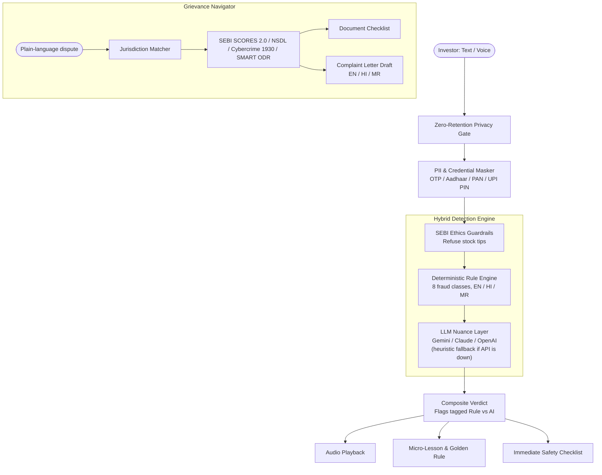

# 🛡️ Nivesh Suraksha (निवेश सुरक्षा)

### Multilingual Investor Scam Checker & Grievance Guide

**Built for the SANGYAN Hackathon · Organized by SNTC, IIT (BHU) Varanasi with SEBI & NSDL**

> **Detect → Understand → Act.** Check a suspicious investment message in your own language, learn why it is a trap, and get a ready-to-file complaint if you have already been affected.

**Track:** A (Digital Fraud & Scam Resilience), with Track B (Investor Awareness, Rights & Grievance) as a secondary fit.

| | |
|---|---|
| 🎥 Demo video | _add link_ |
| 🌐 Live demo | _add link (optional)_ |
| 👥 Team | _add names_ |

---

## 📑 Table of Contents

- [Problem & Motivation](#-problem--motivation)
- [Solution](#-solution)
- [Core Features](#-core-features)
- [Architecture](#-architecture)
- [Guardrails & Privacy-by-Design](#-guardrails--privacy-by-design)
- [Tech Stack & Third-Party Disclosure](#-tech-stack--third-party-disclosure)
- [Project Structure](#-project-structure)
- [Quick Start](#-quick-start)
- [Demo Walkthrough](#-demo-walkthrough)
- [Documentation](#-documentation)
- [Roadmap](#-roadmap)
- [Disclaimer](#-disclaimer)
- [License](#-license)

---

## 📌 Problem & Motivation

First-time retail investors across Tier-2 and Tier-3 India are targeted on WhatsApp, Telegram, and social media with fraudulent "100% guaranteed returns", fake SEBI certificates, and operator pump-and-dump tips.

When victimised, they face confusing regulatory channels and often miss the critical **golden hour (2 to 4 hours)** in which stolen funds can still be frozen. Most financial safety tools are English-heavy and assume financial literacy.

## 💡 Solution

Nivesh Suraksha is a lightweight, mobile-first web app that helps investors:

1. **Detect** scams in real time, by text or voice, in English, Hindi, or Marathi.
2. **Understand** the psychological traps being used, through plain-language explanations and audio playback.
3. **Act** with a jurisdiction-matched complaint route, a document checklist, and an auto-generated complaint letter.

---

## ✨ Core Features

### 1. Multilingual Scam Checker
- Analyses suspicious messages in **English**, **Hindi (हिन्दी)**, **Marathi (मराठी)**, and transliterated Hinglish.
- **Voice input** using the browser's Web Speech API.
- **Hybrid attribution:** every flag is tagged `[Rule Engine]` or `[AI Nuance Analysis]`, so users and judges can see where it came from.
- **Verdicts:** _Likely scam_, _Suspicious_, _No clear red flags found_, plus an explicit _I'm not sure_ state. The app never claims certainty.
- **Audio playback** (text-to-speech) for low-literacy and elderly users.

### 2. Psychological Micro-Lessons
- Explains _why_ the user was vulnerable (e.g. _The Certainty Illusion_, _Fabricated Urgency_, _The Social Proof Trap_).
- Leaves users with a memorable rule: _"In finance, if the return is guaranteed, the fraud is guaranteed."_

### 3. SEBI Advisor Legitimacy Guide
- Explains official registration prefixes: `INA` (Investment Advisers) and `INH` (Research Analysts).
- Covers 4 common impersonation tricks (fake certificates, personal UPI payment requests, 50-50 profit splits, and more).
- Links out to SEBI's official recognised-intermediaries database on `sebi.gov.in`. No registry data is scraped or faked.

### 4. Plain-Language Grievance Navigator
- Maps a casual problem statement to the right forum: **Broker Grievance**, **Depository (NSDL/CDSL)**, **SEBI SCORES 2.0**, **SMART ODR**, or the **National Cybercrime Reporting Portal (1930 / cybercrime.gov.in)**.
- Interactive, checkable **document checklist**.
- **Ready-to-copy formal complaint letter** in English, Hindi, or Marathi with one-click clipboard copy.

### 5. Accessibility for Elderly & Rural Users
- **High-contrast mode** for low vision.
- **Dynamic font scaling** (Aa+ / Aa−).
- Large, thumb-friendly tap targets and a mobile-first layout.

---

## 🏛️ Architecture



**Design note:** the deterministic rule engine always runs first. If the LLM provider is unavailable, the app falls back to rules and the local reasoner, so core protection never goes offline.

---

## 🔒 Guardrails & Privacy-by-Design

| Principle | Implementation |
|---|---|
| **Zero data retention** | No database, no user profiling, no message logging. Everything is processed in memory. |
| **PII & credential masking** | Client-side and server-side detection and redaction of Aadhaar (12 digits), PAN, phone numbers, OTPs, UPI PINs, and bank account numbers. |
| **No investment advice** | Hard filters reject requests for stock tips, buy/sell/hold calls, price targets, or market predictions, and redirect users to SEBI-registered advisers. |
| **No commercial bias** | No broker promotion, affiliate links, upsells, or monetisation. |
| **Honest uncertainty** | Confidence levels on every verdict and an explicit "I'm not sure" state. |
| **Abuse protection** | Rate limiting, input length limits, and sanitisation on all endpoints. |

---

## 🧰 Tech Stack & Third-Party Disclosure

| Layer | Technology |
|---|---|
| Frontend | React 18, Vite, Tailwind CSS (PWA-friendly, mobile-first) |
| Backend | Node.js, Express |
| Speech | Browser Web Speech API (recognition and synthesis) |
| LLM (configurable) | Google Gemini, Anthropic Claude, or OpenAI, with strict JSON output schema |
| Detection | Custom multilingual regex rule engine, local heuristic reasoner (offline fallback) |
| Testing | Automated backend suite (29 tests) |

LLM calls receive only **masked** text. No user data is stored by this application. Third-party APIs are used under their own terms and are disclosed here per hackathon guidelines.

---

## 📂 Project Structure

```
nivesh-suraksha/
├── client/                         # Frontend (React 18 + Vite + Tailwind CSS)
│   ├── src/
│   │   ├── components/             # Navbar, ScamChecker, AnalysisResult, AdvisorGuide,
│   │   │                           # GrievanceNavigator, MicroLesson, PrivacyNotice
│   │   ├── data/                   # Translations (EN, HI, MR), sample scams, grievances
│   │   ├── utils/                  # Speech synthesis & recognition, client PII detector
│   │   ├── App.jsx                 # Main view & tab switcher
│   │   ├── main.jsx                # React entrypoint
│   │   └── index.css               # Tailwind tokens & high-contrast styles
│   ├── package.json
│   └── vite.config.js
├── server/                         # Backend (Node.js + Express)
│   ├── src/
│   │   ├── config/env.js           # Environment config & provider router
│   │   ├── data/
│   │   │   ├── grievance_knowledge.json   # Forums, steps, and official sources
│   │   │   └── sampleData.js              # 10 seed scams & 3 grievance scenarios
│   │   ├── middleware/             # Rate limiting, length validation, sanitisation
│   │   ├── services/
│   │   │   ├── piiMasker.js        # Detect & redact Aadhaar/PAN/OTP/PIN
│   │   │   ├── guardrailFilter.js  # Reject stock-advice requests
│   │   │   ├── ruleEngine.js       # Multilingual regex heuristics (EN, HI, MR, Hinglish)
│   │   │   ├── localReasoner.js    # Offline heuristic fallback & micro-lessons
│   │   │   ├── llmService.js       # Gemini / Claude / OpenAI client, strict schema
│   │   │   └── grievanceEngine.js  # Dispute classification & localised complaint drafts
│   │   ├── routes/                 # /api/analyze, /api/grievance, /api/samples
│   │   ├── app.js                  # Express app configuration
│   │   └── server.js               # Server entrypoint
│   ├── test/
│   │   └── test-engine.js          # Automated test suite (29 tests)
│   └── package.json
├── docs/                           # Hackathon documentation bundle
│   ├── problem_statement.md
│   ├── solution_overview.md
│   ├── technology_details.md
│   ├── privacy_and_guardrails.md
│   ├── impact_and_scalability.md
│   └── demo_script.md
├── .env.example                    # Environment variable template
└── README.md
```

---

## 🚀 Quick Start

### Prerequisites
- Node.js v18 or higher (tested on v25)
- npm v9 or higher

### 1. Clone and install

```bash
git clone <your-repo-url>
cd nivesh-suraksha

# Server dependencies
cd server && npm install

# Client dependencies
cd ../client && npm install
```

### 2. Configure environment

Copy the template and add your key. Place the `.env` file where `server/src/config/env.js` loads it from.

```bash
cp .env.example .env
```

Set your preferred LLM provider and API key in `.env`. **No API key? No problem.** The app runs in rules-plus-local-reasoner mode without one.

### 3. Run the tests

```bash
cd server
npm test
```

The 29 tests cover PII redaction, guardrail enforcement, rule-engine pattern matching, and grievance draft generation.

### 4. Start the backend

```bash
cd server
npm start
```

The API runs on `http://localhost:5000`.

### 5. Start the frontend

In a separate terminal:

```bash
cd client
npm run dev
```

Open `http://localhost:5173` in your browser.

---

## 🎯 Demo Walkthrough

The app ships with 10 clickable seed scams and 3 grievance scenarios.

| ID | Language | Category | Key red flags triggered |
|---|---|---|---|
| `scam-1` | English | Upper Circuit Pump | Guaranteed profit, operator leak, artificial scarcity, VIP Telegram |
| `scam-2` | Hindi | Guaranteed Doubling | 100% पक्का रिटर्न, पैसे दोगुना, रात 12 बजे तक केवल 3 सीटें |
| `scam-3` | Marathi | Advance UPI Fee | खात्रीशीर जॅकपॉट कॉल, १००% गॅरंटीड परतावा, वैयक्तिक गुगल पे वर पैसे पाठवा |
| `scam-4` | Hinglish | Operator Leak Blast | Operator ka leak, 100% sure shot, WhatsApp VIP group |
| `scam-5` | English | Demat KYC Phishing | Account suspension threat, urgency, OTP demand |
| `scam-6` | Hindi | Fake SEBI Endorsement | सेबी प्रमाणित मुनाफा, फर्जी सेबी अप्रूवल लेटर |
| `scam-7` | Marathi | Account Handling P&L | २ लाख कमावले, डिमॅट खाते हँडल करू, ५०% नफा भागीदारी |
| `scam-8` | English | Binary Options Bot | 95% guaranteed payout in 60s, AI auto-trade doubler |
| `scam-9` | Hinglish | Contest UPI PIN Scam | Won Rs 45,000 bonus, enter secret UPI PIN to receive money |
| `scam-10` | English | Clean Exchange Advisory | NSE circular (confirms benign messages trigger zero false positives) |

**Suggested demo flow (3 to 5 minutes):**
1. Paste or speak `scam-2` in Hindi, then review the verdict, tagged flags, and audio playback.
2. Open the micro-lesson to see why the message works psychologically.
3. Switch to the Grievance Navigator, describe a fraud, and copy the generated complaint letter.
4. Show High-Contrast mode and font scaling, then the privacy notice and PII masking.

---

## 📚 Documentation

Full hackathon submission documents are in [`/docs`](./docs):

- [Problem Statement](./docs/problem_statement.md)
- [Solution Overview](./docs/solution_overview.md)
- [Technology Details](./docs/technology_details.md)
- [Privacy & Guardrails](./docs/privacy_and_guardrails.md)
- [Impact & Scalability](./docs/impact_and_scalability.md)
- [Demo Script](./docs/demo_script.md)

---

## 🗺️ Roadmap

- WhatsApp bot, where scams actually circulate
- More Indian languages via Bhashini translation
- Offline-first mode for low-connectivity regions
- Crowd-reported scam-pattern library to improve detection over time
- Partnership pathway with SEBI/NSDL as a public-good investor protection tool

---

## ⚠️ Disclaimer

Nivesh Suraksha is an educational investor-protection tool. It does **not** provide investment advice, stock tips, or predictions, and it is **not** a substitute for legal counsel. Verdicts are indicative, not definitive. Always verify advisers on the official SEBI website and report fraud through official channels. Forum details, links, and helpline numbers should be re-verified against official sources before relying on them.

---

## 📄 License

Released under the [MIT License](./LICENSE) for the IIT (BHU) SANGYAN Hackathon in collaboration with SEBI and NSDL.
