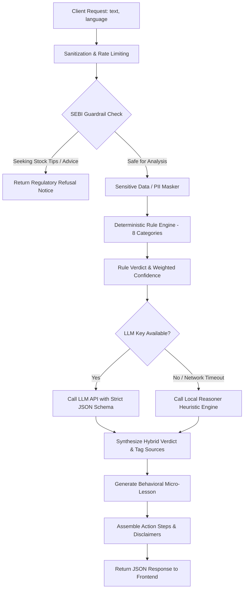

# Technology Details & Engineering Architecture

## 1. Technology Stack

| Layer | Technology | Rationale |
|---|---|---|
| **Frontend Framework** | React 18 + Vite | Lightning-fast HMR, lightweight bundle (~236 KB JS, ~27 KB CSS gzip), mobile-first PWA responsiveness. |
| **Styling & Accessibility** | Tailwind CSS | High flexibility, custom high-contrast mode tokens, responsive layout, accessible typography. |
| **Icons** | Lucide React | Clean, scalable vector icons without third-party web font dependencies. |
| **Voice APIs** | Web Speech API | Native browser `SpeechRecognition` and `SpeechSynthesisUtterance` with zero client-side payload or cloud audio bandwidth cost. |
| **Backend API** | Node.js + Express (ES Modules) | High-concurrency event-loop, zero cold-start delay, modular services architecture. |
| **Detection Engine** | Hybrid (Regex + LLM) | Deterministic rule matching running in sub-5ms paired with semantic AI reasoning. |
| **LLM Provider Layer** | Gemini 1.5 Flash / Claude / Local Fallback | Configurable via `.env`, strict JSON generation schema, zero-crash offline heuristic fallback. |

## 2. Detection Pipeline Details

## 3. Deterministic Rule Engine Specifications

The rule engine inspects normalized input strings across 8 categories with weighted severity:

| Category ID | Weight | Target Patterns | Severity |
|---|---|---|---|
| `guaranteed_returns` | 35 | "100% guarantee", "पक्का मुनाफा", "खात्रीशीर नफा", "2x in 7 days", "zero risk profit" | CRITICAL |
| `credential_payment_theft` | 40 | "share OTP", "enter UPI PIN to receive", "transfer to personal account", "processing fee first" | CRITICAL |
| `artificial_urgency` | 20 | "only 3 seats left", "offer expires tonight", "लवकर करा", "jaldi karo slot closes" | HIGH |
| `insider_operator_claims` | 25 | "operator leak", "100% jackpot call", "अंदर की खबर", "sure shot breakout" | HIGH |
| `private_group_migration` | 15 | "join VIP Telegram", "DM on WhatsApp", "t.me/...", "chat.whatsapp.com/..." | MEDIUM |
| `fake_sebi_credentials` | 35 | "SEBI approved guaranteed profit", "सेबी प्रमाणित पक्का रिटर्न", "Govt certified 100%" | CRITICAL |
| `unrealistic_screenshots` | 15 | "made 5 lakhs in 10 mins", "P&L screenshot attached", "खाते आम्ही हँडल करू" | MEDIUM |
| `unregulated_crypto_forex` | 25 | "binary options 60 seconds", "AI Forex trading bot", "crypto doubler" | HIGH |

### Scoring & Verdict Mapping:
- **Composite Score >= 40:** Verdict: `"Likely scam"`, Base Confidence: 65%–96%.
- **Composite Score 15 to 39:** Verdict: `"Suspicious"`, Base Confidence: 45%–85%.
- **Composite Score > 0 (< 15):** Verdict: `"Suspicious"`, Confidence: 40% (marked uncertain).
- **Composite Score 0:**
  - If text is very short (< 6 words): Verdict: `"I'm not sure"`, Confidence: 25% (explicit uncertainty).
  - If substantive text with no triggers: Verdict: `"No clear red flags found"`, Confidence: 75%.

## 4. LLM Nuance Layer & Local Fallback
When external LLM keys are configured (`GEMINI_API_KEY`, `ANTHROPIC_API_KEY`, or `OPENAI_API_KEY`), the service invokes the cloud model with temperature 0.2 and strict JSON schemas.

If no key is configured or the API experiences network latency:
- The system automatically engages `localReasoner.js`.
- Generates psychological behavioral insights ("The Certainty Illusion", "Fabricated Time Pressure", "Social Proof Trap").
- Provides localized action checklists in English, Hindi, and Marathi.
- Ensures the application remains **100% demo-ready and usable offline**.

## 5. Grievance Knowledge Representation
Official forums, regulatory statutes, and contact matrices are managed in `grievance_knowledge.json`.
- Each forum includes verifiable `source` attributes pointing to official regulatory bodies (SEBI, NSDL, CDSL, Ministry of Home Affairs).
- Automated string templating produces formatted formal legal complaints with date localization and placeholders (`[Your Name]`, `[Transaction ID]`, `[Client Code]`).
